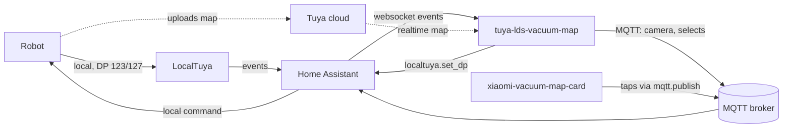

# tuya-lds-vacuum-map

A live, clickable map for Tuya LDS (laser) robot vacuums in Home Assistant.

Many robot vacuums sold under different brands run on the same laser-navigation platform and talk to the
world through Tuya. In the Tuya cloud they show up as **"Lds Robot"**. Home Assistant can already control
them locally with [LocalTuya](https://github.com/xZetsubou/hass-localtuya), but there is no map: the map lives
in the vendor app. This service brings it to Home Assistant, draws it the way the app does, and turns taps on
the map into cleaning commands sent over the local network.

> Status: early. It runs every day against one robot (a KaBuM! Smart 900). Expect rough edges, and please
> report what you find.

## Features

| Status | Feature | Notes |
|---|---|---|
| Done | Map from the Tuya cloud | Walls, rooms and obstacles, refreshed during and after every cleaning |
| Done | Local-only mode | Uses the last cloud map and paints the floor the robot covers since then; works with no cloud at all, from the path alone |
| Done | Live path and robot position | From the robot's local path messages, every ~2 s |
| Done | Room names, as in the app | Read from the robot, so renaming a room in the app shows up here |
| Done | Per-room suction and water icons | Shown while per-room settings are on |
| Done | Areas and no-go zones | Read from the robot; edit them in the app and the map follows |
| Done | Tap a room to clean it | Local command, no cloud |
| Done | Tap an area to clean it | Uses the areas as they are on the robot |
| Done | Double tap a room to open its settings | Selects the room on a Home Assistant select and fires an event |
| Done | Spot cleaning | Tap a point, the 1.5 m square is drawn while the robot works on it |
| Done | Map source switch | `Automatic` (cloud while it answers, local otherwise) or `Local only`, from Home Assistant |
| Done | English and Brazilian Portuguese | Entity names and map labels |
| Planned | Draw an area and clean it | Needs the app's zone command captured ([roadmap](#roadmap)) |
| Planned | Clean one area when the robot has several | Today a tap on an area cleans all of the robot's areas |
| Planned | Edit room settings, areas and no-go zones from the map | Today they are edited in the app or through Home Assistant helpers |
| Not possible | Live map without the cloud | The robot only sends the path locally; the walls go to the cloud ([why](docs/protocol.md#data-points)) |

## How it works



1. LocalTuya already receives everything the robot sends. The service listens to those events through the
   Home Assistant websocket: the robot state, the live path (DP 123) and the room list, areas and commands
   (DP 127).
2. When a cloud project is configured, it downloads the robot's realtime map from the Tuya cloud during and
   after each cleaning. The map is a grid of 5 cm cells where each cell holds a room id, a wall or nothing.
3. It draws the map with Pillow, flipped and coloured like the app, adds names, settings, areas, the dock,
   the path and the robot, and publishes it to MQTT as a Home Assistant camera, with calibration points for
   the card.
4. [xiaomi-vacuum-map-card](https://github.com/PiotrMachowski/lovelace-xiaomi-vacuum-map-card) shows the
   camera. A tap publishes its coordinates back to MQTT; the service finds the room or area under the finger
   and sends the cleaning command through LocalTuya.

The protocol details, with examples, are in [docs/protocol.md](docs/protocol.md).

## Supported robots

| Robot | Tuya product | Status |
|---|---|---|
| KaBuM! Smart 900 (KBSF009, KBSF010, KBSF011, KBSF012) | `Lds Robot`, `7vx4ulan46paequq` | Confirmed |

Robots from other brands that appear in the Tuya cloud as "Lds Robot", or whose LocalTuya data points
include `path_comm` (123) and `comm_raw` (127), are likely to work. If you have one, please follow
[Adding a robot](CONTRIBUTING.md#adding-a-robot) and open an issue with what you find, working or not.

## Requirements

- Home Assistant with:
  - [LocalTuya](https://github.com/xZetsubou/hass-localtuya) set up for the robot. The service listens to its
    `localtuya_device_dp_triggered` and `localtuya_status_update` events and sends commands with
    `localtuya.set_dp`.
  - The MQTT integration, with discovery on.
  - [xiaomi-vacuum-map-card](https://github.com/PiotrMachowski/lovelace-xiaomi-vacuum-map-card), from HACS.
  - A long-lived access token.
- An MQTT broker the service can reach.
- Optional, for the cloud map: a project on the [Tuya developer platform](https://platform.tuya.com) with the
  **IoT Core** service and the **Sweeping Robot Open Service** API, linked to the app account that owns the
  robot. Without it the service runs in local-only mode.

## Installation

The service is a container. With Docker Compose:

```yaml
services:
  vacuum-map:
    image: ghcr.io/maikemota/tuya-lds-vacuum-map:0.1.0
    restart: unless-stopped
    environment:
      TUYA_DEVICE_ID: your-device-id
      HA_URL: http://homeassistant:8123
      HA_TOKEN: ${HA_TOKEN}
      MQTT_HOST: mosquitto
      MQTT_USERNAME: vacuum-map
      MQTT_PASSWORD: ${MQTT_PASSWORD}
      TUYA_CLOUD_CLIENT_ID: ${TUYA_CLOUD_CLIENT_ID}
      TUYA_CLOUD_CLIENT_SECRET: ${TUYA_CLOUD_CLIENT_SECRET}
      TUYA_CLOUD_REGION: eu
      LANGUAGE: en
      DEVICE_NAME: Robot vacuum
    volumes:
      - ./vacuum-map:/data
```

The image is not published yet; until it is, build it from this repository with `docker build -t
tuya-lds-vacuum-map .`.

### Settings

| Variable | Required | Default | Meaning |
|---|---|---|---|
| `TUYA_DEVICE_ID` | yes | | The robot's Tuya device id, as in LocalTuya |
| `HA_URL` | yes | | Home Assistant URL |
| `HA_TOKEN` | yes | | Long-lived access token |
| `MQTT_HOST` | yes | | MQTT broker host |
| `MQTT_PORT` | | `1883` | |
| `MQTT_USERNAME`, `MQTT_PASSWORD` | | | |
| `TUYA_CLOUD_CLIENT_ID`, `TUYA_CLOUD_CLIENT_SECRET`, `TUYA_CLOUD_REGION` | | | Cloud project; region is `us`, `eu`, `cn`, `in` or `sg`. Leave them out for local-only |
| `LANGUAGE` | | `en` | `en` or `pt-BR` |
| `DEVICE_NAME` | | `Vacuum map <id>` | Name of the Home Assistant device the entities belong to |
| `DATA_DIR` | | `/data` | Where the last map, the rooms and the covered floor are kept between restarts |
| `STATE_DP`, `PATH_DP`, `RAW_DP`, `ROOM_MODE_DP` | | `105`, `123`, `127`, `144` | Data point numbers, for robots that differ |
| `CLOUD_REFRESH_SECONDS` | | `60` | How often the cloud map is fetched while the robot moves |
| `DOUBLE_TAP_SECONDS` | | `0.6` | Window for a double tap; a single tap waits this long before cleaning |
| `FONT_PATH` | | DejaVu Sans | TrueType font for the labels |
| `LOG_LEVEL` | | `INFO` | |

## Home Assistant setup

The service creates, through MQTT discovery:

| Entity | What it is |
|---|---|
| `camera.<device>_map` | The map, with `calibration_points`, `robot_state`, `map_source` and `rooms` attributes |
| `select.<device>_map_source` | `Automatic` or `Local only` |
| `select.<device>_room_settings` | The room picked by a double tap, or `None` |

A double tap also fires the `tuya_lds_vacuum_map_room_settings` event with `device_id`, `room_id` and
`room_name`, for automations.

The card needs two map modes that publish taps to the service. Replace the device id in the topic:

```yaml
type: custom:xiaomi-vacuum-map-card
entity: vacuum.robot
map_source:
  camera: camera.robot_vacuum_map
calibration_source:
  camera: true
map_modes:
  - name: Tap to clean, double tap for settings
    icon: mdi:gesture-tap
    selection_type: MANUAL_POINT
    coordinates_rounding: true
    run_immediately: true
    service_call_schema:
      service: mqtt.publish
      service_data:
        topic: tuya_lds_vacuum_map/<device-id>/tap
        payload: '{"mode": "room", "x": [[point_x]], "y": [[point_y]]}'
  - name: Spot cleaning
    icon: mdi:map-marker-radius
    selection_type: MANUAL_POINT
    coordinates_rounding: true
    service_call_schema:
      service: mqtt.publish
      service_data:
        topic: tuya_lds_vacuum_map/<device-id>/tap
        payload: '{"mode": "spot", "x": [[point_x]], "y": [[point_y]]}'
```

To show a room's settings below the map after a double tap, use a `conditional` card on
`select.<device>_room_settings` for each room.

## Map source

| Mode | Cloud calls | What is drawn |
|---|---|---|
| Automatic | During and after each cleaning, and every 6 h | The latest cloud map, plus the floor covered since it was fetched |
| Local only | None | The last cloud map saved, plus every bit of floor the robot covered since; with no saved map, only the covered floor |

If the cloud stops answering, for example when the IoT Core subscription expires, Automatic keeps drawing
from the saved map and the live path, so nothing breaks; the walls simply stop updating.

## Roadmap

Planned work is tracked as [issues](https://github.com/MaikeMota/tuya-lds-vacuum-map/issues) grouped in
[milestones](https://github.com/MaikeMota/tuya-lds-vacuum-map/milestones). In short:

- **0.2, ship it**: container image published by CI, Home Assistant add-on packaging, a dashboard example.
- **0.3, more cleaning**: draw an area and clean it, clean one area among several, show the robot heading.
- **0.4, edit from the map**: room settings, areas and no-go zones written to the robot from Home Assistant.
- **Local map**: better room borders for the covered floor (walking distance instead of straight-line),
  forgetting floor that was not seen for a long time, and a map with no cloud from the start.
- **More robots**: every confirmed model listed above.

## Contributing

Bug reports, robot reports and pull requests are welcome. [CONTRIBUTING.md](CONTRIBUTING.md) explains how to
run it, how the code is laid out and how to add a robot.

## Acknowledgements

- [LocalTuya](https://github.com/xZetsubou/hass-localtuya), which does the hard part of talking to the robot.
- [xiaomi-vacuum-map-card](https://github.com/PiotrMachowski/lovelace-xiaomi-vacuum-map-card), which draws the
  map and turns taps into coordinates.
- [Xiaomi Cloud Map Extractor](https://github.com/PiotrMachowski/Home-Assistant-custom-components-Xiaomi-Cloud-Map-Extractor),
  whose Roidmi parser showed that this map format is shared across brands.
- [tuya-vacuum-maps](https://github.com/cornguo/tuya-vacuum-maps), which pointed at the cloud map endpoint.
